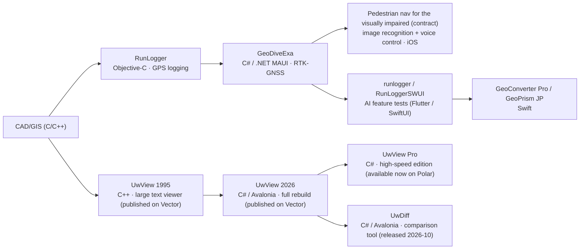

<h1 align="center">y4u</h1>

<p align="center"><em><a href="README.md">日本語</a> ｜ English</em></p>

<p align="center">
  I build non-business software, mainly in the CAD / GIS and engineering domains.<br>
  Currently building surveying / geodesy apps for iOS and desktop tools for searching and comparing huge files (the UwView series).
</p>

<p align="center">
  
  
  
  
  
</p>

---

## 📱 Released apps

### Search and compare huge files — the UwView series (Windows, macOS, Linux)

**Search with UwView, compare with UwDiff.** Each ships a GUI and a CLI in one package. Website: [uvp.y42u.net](https://uvp.y42u.net/en/)

| App | CLI | What it does | Get it |
| --- | --- | --- | --- |
| **[UwView](https://github.com/amru195704/UwView)** | `uvf` | A viewer for opening and searching huge logs and text. Search from the CLI and send the hits straight to the window with `-open`. Also searches inside 7 compression formats (gz, bz2, xz, lzma, zst, lz4, br) and the text of Word, Excel and PDF files | [Releases](https://github.com/amru195704/UwView/releases/latest) · Homebrew · Scoop · Snap · [try it in the browser](https://amru195704.github.io/UwView/) |
| **[UwView Pro](https://uvp.y42u.net/en/pro-en/)** | `uvp` | The paid edition of UwView. It saves an index (`.uwvz`), so from the second time on files open instantly and searches are faster; keep originals at about 1/9 the size and still read them. Editing via the Edit Upgrade | [Product page](https://uvp.y42u.net/en/pro-en/) (14-day trial) |
| **[UwDiff](https://github.com/amru195704/UwDiff)** | `uvd` | Compares two files or two folders: text, CSV/TSV/Excel matched by key columns (row order may differ), compressed files, and the text of Word/Excel/PDF; UTF-8, Shift-JIS, EUC-JP and UTF-16 | [Releases](https://github.com/amru195704/UwDiff/releases/latest) · [Overview](https://uvp.y42u.net/en/uwdiff-en/) |

```bash
# Install UwView (this also gives you the uvf command)
brew install --cask amru195704/uwview/uwview                                         # Mac (Homebrew)
scoop bucket add uwview https://github.com/amru195704/scoop-uwview; scoop install uwview   # Windows (Scoop)
sudo snap install uwview                                                             # Linux (Snap Store)
```

### Surveying and geodesy (iOS)

A family of apps specialized for Japan's geodetic systems, supporting fieldwork and learning in surveying and geodesy.

| App | Description | Links |
| --- | --- | --- |
| **GeoConverter Pro** | Dedicated coordinate-conversion app. World geodetic / Japan plane-rectangular systems, with semi-dynamic and steady-state crustal-movement correction | [App Store](https://apps.apple.com/jp/app/geoconverter-pro/id6761740960) ・ [Web](https://gcpro.y42u.net/) |
| **GeoPrism JP** | Learning app that visualizes datum shifts and the geoid on maps and heatmaps | [App Store](https://apps.apple.com/app/id6780149823) ・ [Web](https://gmp.y42u.net/) |
| **GeoDiveExa** | High-precision RTK-GNSS survey app (the origin of the coordinate-conversion engine) | [Web](https://y42u.net/tec001/) |

> **GeoConverter Pro** and **GeoPrism JP** share **GeoCoreJP** (a Swift Package), the coordinate-conversion engine extracted from GeoDiveExa.

---

## 📚 Kindle books (now on sale)

Three books — read / build / play — explaining how Japan's geodetic systems work, now available on Kindle (in Japanese, Kindle Unlimited eligible):

- [*Understanding Japan's Geodetic Systems*](https://www.amazon.co.jp/dp/B0H971W8WX) — why Japan's map coordinates keep shifting, told as one story from TOKYO to JGD2024
- [*Understanding Japan's Geodetic Systems — Implementation*](https://www.amazon.co.jp/dp/B0H97LPNH3) — build a coordinate-conversion engine in Python and match GSI's official results to 1 mm
- [*Japan's Geodetic Systems Q&A*](https://www.amazon.co.jp/dp/B0HF4SJC1L) — 100 quiz questions on maps, GPS and coordinates; test yourself, then dive into vol. 1

> 🎁 All three volumes are included in **Kindle Unlimited** (free to read for members).

The test Python scripts used in the "Run it in Python to verify" sections of the Implementation volume are published under [geodetic-book-py](geodetic-book-py/README.md).

---

## 📝 Note (alternate-history fantasy, in Japanese)

*Shin Nirenkanki* — an alternate-history fantasy that ties 400 years of Japan, from the Warring States period to the modern World Cup, together through a "prophecy of the ring." Japanese only.

**📖 Now on Kindle.** The main story is complete in six volumes, with side stories following — each narrative volume pairs with an "answer-check" companion that sorts fact from fiction. Start with [vol. 1](https://www.amazon.co.jp/dp/B0HC2Y5T6L). (The old paid note.com content has been taken down and folded into the Kindle edition.)

Free pieces on note.com (in Japanese):

- A 5-minute intro for newcomers [note.com](https://note.com/amru1957/n/nec43a60fb81d)
- To mark the finale: a first-time AI reads all six volumes in one go — praise and pans as they came [note.com](https://note.com/amru1957/n/ncf1ea19b6ffe)
- Making-of: "I published eight novels in twelve days (and every cost involved)" [note.com](https://note.com/amru1957/n/n2cc8755586a2)

---

## 🧰 Projects (GitHub)

| Repository | Description | License |
| --- | --- | --- |
| [**UwView**](https://github.com/amru195704/UwView) | Viewer for gigantic text and logs, plus the `uvf` CLI (Avalonia / .NET 10 · Windows / macOS / Linux / WASM). Automatic encoding detection, full-text search, real-time tail. **Verified up to 258.68 GB / 4,509,830,821 lines** (OpenStreetMap for the whole USA expanded to XML, measured with UwView Pro) | [UwView License](https://github.com/amru195704/UwView/blob/main/LICENSE) |
| [**UwDiff**](https://github.com/amru195704/UwDiff) | Tool for comparing two files or folders, plus the `uvd` CLI (.NET 10 · Windows / macOS / Linux). Key matching of two 10 GB CSV files in about 21 s, two 10 GB text files in about 21 s (measured on a Mac mini M4; [full tables, conditions and losses](https://github.com/amru195704/UwDiff/blob/main/docs/benchmarks.md)) | [UwDiff License](https://github.com/amru195704/UwDiff/blob/main/LICENSE) |
| [homebrew-uwview](https://github.com/amru195704/homebrew-uwview) · [scoop-uwview](https://github.com/amru195704/scoop-uwview) · [snap-uwview](https://github.com/amru195704/snap-uwview) | Package definitions for installing UwView with Homebrew, Scoop and the Snap Store | — |
| [**geodetic-book-py**](geodetic-book-py/README.md) | Python scripts for checking the results in *Understanding Japan's Geodetic Systems — Implementation* | — |
| [**runlogger**](https://github.com/amru195704/runlogger) | A Flutter test app partially recreating the old Objective-C iOS app "RunLogger" (for evaluating AI features) | Open source |
| [**RunloggerSWUI**](https://github.com/amru195704/RunloggerSWUI) | The same "RunLogger" partially recreated in SwiftUI (for evaluating AI features) | Open source |

> **About the UwView and UwDiff licenses** (this summary does not replace the license text): both are the PolyForm Internal Use License 1.0.0 plus a permission to redistribute the official binaries as packages.
>
> - Free for personal use and for a company's internal business use.
> - Redistribution, bundling into a product/service, resale, providing to third parties, hosting, or OEM embedding require a separate commercial (redistribution/OEM) license from the author.
> - However, **the official, unmodified binaries may be redistributed free of charge as packages** (Flathub, Snap, AUR, Linux distribution repositories, Homebrew, Scoop, winget and so on). The conditions are in the "Additional Permission" section of each LICENSE.
> - Neither is open-source software.

> **UwView Pro, measured** (against [klogg](https://klogg.filimonov.dev/); OpenStreetMap Japan, 47.73 GB / 892,239,125 lines, external USB, 32 GB RAM, 10-core Mac; hit counts verified identical to klogg):
>
> - **Re-open (2nd time on): 0.02–0.07 s** (klogg re-indexes every time, ~110 s)
> - **Full-text search "Tokyo": 14.3 s** (klogg 120–135 s = ~9×; ~8.6× case-insensitive, ~4.4× regex)
> - **Archive mode: delete the original and keep 48 GB → 5.3 GB (~1/9)**, opened directly (checksum-protected)
> - **The whole USA, 258.68 GB / 4.51 billion lines** (2026-07-26, separate conditions): first open including the index build 5 min 28 s, instant on every reopen; full-text search stays at ~34 s regardless of the term or hit count ("New York": 34.8 s, 100,492 hits) — proof that line numbers must be held as `long`

---

## 🧭 How it evolved

My personal iOS / cross-platform apps grew out of **RunLogger**, a GPS-logging app.



Starting from RunLogger (GPS logging), I built **GeoDiveExa** (C#). I then developed, under contract, a **pedestrian navigation app for the visually impaired** (an iOS app that uses *image recognition* as a substitute for sight and *voice* for control). As an **AI feature study** I prototyped runlogger / RunLoggerSWUI, and applied what I learned to build **GeoConverter Pro / GeoPrism JP** in Swift.

**UwView** has a separate origin: a large text viewer I first wrote in **C++** in 1995 (published on Japan's "Vector" archive), fully rebuilt in **C# / Avalonia** in 2026, and now extended into the high-speed **UwView Pro** and the sister comparison tool **UwDiff**.

---

## 👤 Background

- **Experience**: 40+ years of software development. I specialize in non-business engineering domains, from CAD / GIS to radio and geodesy.
- **Highlights**:
  - **A CAD system I developed ~40 years ago (early 1980s) on an Apollo workstation is still in use today as a CATV (cable-TV) design CAD** ([the story from back then](https://y42u.net/tec001/2024/06/17/1980/))
  - **Developed a radio-wave propagation simulator during the transition to terrestrial digital broadcasting**
  - Developed a CAD system for creating car-navigation map data
- **Main field**: CAD / GIS and engineering software (non-business)
- **Qualification**: First-Class Radio Engineer (now First-Class Technical Radio Operator for On-The-Ground Services)
- **Now**: developing surveying / geodesy apps for iOS and desktop tools for huge files (the UwView series)

## 🛠 Tech stack

- **Languages**: C / C++ / Python / C# / Swift
- **iOS**: Swift / SwiftUI / MapKit
- **Cross-platform**: .NET MAUI (field apps) · Avalonia UI (desktop / WASM) · Flutter
- **Domains**: CAD (CATV design / car-navigation map data) · GIS · RTK-GNSS positioning · geodetic-datum conversion (TKY2JGD / semi-dynamic / pos2jgd) · coordinate projection · image recognition · speech recognition

---

<p align="center"><sub>🌐 <a href="https://y42u.net/">y42u.net</a></sub></p>
