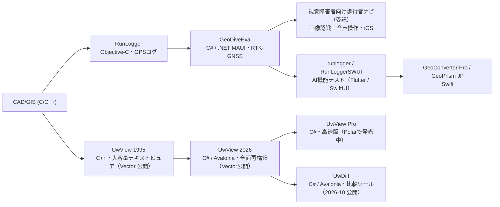

<h1 align="center">y4u</h1>

<p align="center"><em>日本語 ｜ <a href="README.en.md">English</a></em></p>

<p align="center">
  CAD / GIS・エンジニアリング領域を中心に、事務系以外のソフトウェアを開発しています。<br>
  現在は、iOS の測量・測地アプリと、巨大ファイルを探す・比べるデスクトップツール（UwView シリーズ）を開発中。<br>
  <em>Software engineer in CAD/GIS and engineering domains — building geospatial apps for iOS and huge-file tools for the desktop.</em>
</p>

<p align="center">
  
  
  
  
  
</p>

---

## 📱 リリース済みアプリ

### 巨大なファイルを「探す」「比べる」— UwView シリーズ（Windows・macOS・Linux）

**UwView で探して、UwDiff で比べる。** どれも画面（GUI）と CLI を1つの配布物に入れています。公式サイト: [uvp.y42u.net](https://uvp.y42u.net/)

| アプリ | CLI | 内容 | 入手 |
| --- | --- | --- | --- |
| **[UwView](https://github.com/amru195704/UwView)** | `uvf` | 巨大なログ・テキストを開いて探すビューア。CLI で探し、`-open` で結果をそのまま画面へ。7 種類の圧縮ファイル（gz・bz2・xz・lzma・zst・lz4・br）や Word・Excel・PDF の中の文字も探せる | [Releases](https://github.com/amru195704/UwView/releases/latest) ・ Homebrew ・ Scoop ・ Snap ・ [ブラウザで試す](https://amru195704.github.io/UwView/) |
| **[UwView Pro](https://uvp.y42u.net/pro/)** | `uvp` | UwView の有料版。索引（`.uwvz`）を保存して、2回目からは一瞬で開き、速く探す。元ファイルを約 1/9 の大きさで保管・閲覧。編集（Edit Upgrade）も | [製品ページ](https://uvp.y42u.net/pro/)（14日間の試用あり） |
| **[UwDiff](https://github.com/amru195704/UwDiff)** | `uvd` | 2つのファイル・2つのフォルダを比べる。テキスト・CSV/TSV/Excel（キー列で照合、行の順番が違ってもよい）・圧縮ファイル・Word/Excel/PDF の文字、文字コードは UTF-8・Shift-JIS・EUC-JP・UTF-16 | [Releases](https://github.com/amru195704/UwDiff/releases/latest) ・ [紹介ページ](https://uvp.y42u.net/uwdiff/) |

```bash
# UwView を入れる（uvf も使えるようになります）
brew install --cask amru195704/uwview/uwview                                         # Mac（Homebrew）
scoop bucket add uwview https://github.com/amru195704/scoop-uwview; scoop install uwview   # Windows（Scoop）
sudo snap install uwview                                                             # Linux（Snap Store）
```

### 測量・測地（iOS）

日本の測地系に特化した、測量・測地の現場と学習を支えるアプリ群です。

| アプリ | 内容 | リンク |
| --- | --- | --- |
| **GeoConverter Pro** | 座標変換専用アプリ。世界測地系／平面直角座標系、セミダイナミック補正・定常時地殻変動補正に対応 | [App Store](https://apps.apple.com/jp/app/geoconverter-pro/id6761740960) ・ [Web](https://gcpro.y42u.net/) |
| **GeoPrism JP** | 測地系のズレやジオイドを地図・ヒートマップで可視化する学習アプリ | [App Store](https://apps.apple.com/app/id6780149823) ・ [Web](https://gmp.y42u.net/) |
| **GeoDiveExa** | RTK-GNSS 対応の高精度位置調査アプリ（座標変換エンジンの原点） | [Web](https://y42u.net/tec001/) |

> **GeoConverter Pro** と **GeoPrism JP** は、GeoDiveExa から抽出した座標変換エンジン **GeoCoreJP**（Swift Package）を共有しています。

---

## 📚 Kindle本（発売中）

日本の測地系の仕組みを解説する「日本の測地系」シリーズ3冊（読む・作る・あそぶ）を、Kindleで発売中です（Kindle Unlimited 対象）。

| 書籍 | 内容 | リンク |
| --- | --- | --- |
| **『日本の測地系がわかる本』**（本編） | 地図の座標はなぜズレるのか。TOKYOからJGD2024まで、百数十年の「座標の引っ越し」を1本の物語で | [Amazon](https://www.amazon.co.jp/dp/B0H971W8WX) |
| **『日本の測地系がわかる本（実装編）』** | 座標変換エンジンをPythonで作って、国土地理院の計算と1mmで一致させる | [Amazon](https://www.amazon.co.jp/dp/B0H97LPNH3) |
| **『日本の測地系Q&A』** | 地図・GPS・座標の「なぜ？」がわかる100問。クイズで腕試しする第3巻 | [Amazon](https://www.amazon.co.jp/dp/B0HF4SJC1L) |

> 🎁 3冊すべて **Kindle Unlimited 対象**（会員は追加料金なしで読めます）。
> 🧩 腕試し用の試食10問（無料・note）: [【地図クイズ10問】緯度1度は何メートル？](https://note.com/amru1957/n/n9cba2ac8d167)

「実装編」の各章「Pythonで動かして確かめる」節で使うテスト用 Python スクリプトを [geodetic-book-py](geodetic-book-py/README.md) 以下に公開しています。

---

## 📝 歴史改変ファンタジー〈円環年代記〉（Kindle・発売中）

もし、あの国の歴史が「ひとつの征服の物語」だったとしたら――。戦国から現代へ、さらに太古と未来へ。生成AIとの共作で書いた歴史改変ファンタジーです。**本編は全6巻で完結し、以降は外伝を刊行しています。** 物語の各巻には、事実と創作を判子で仕分ける「答え合わせ編」付き（Kindle Unlimited 対象）。

**▶ 入口**

- 第1巻『シン・二連環記 ―日出ずる国の円環年代記―』 [Amazon](https://www.amazon.co.jp/dp/B0HC2Y5T6L)
- 【5分で分かる】超入門 ―はじめての方へ―（note・無料） [note.com](https://note.com/amru1957/n/nec43a60fb81d)
- 【完結記念】初見のAIに本編6巻を一気読みさせた書評 ―絶賛も酷評もそのまま―（note・無料） [note.com](https://note.com/amru1957/n/ncf1ea19b6ffe)
- 制作記「12日間で小説を8冊出した話（と、その費用の全部）」（note・無料） [note.com](https://note.com/amru1957/n/n2cc8755586a2)

> note で販売していた旧有料コンテンツ（マガジン・原型版・設定資料集）は公開を終了し、Kindle 版へ統合済みです。

---

## 🧰 プロジェクト（GitHub）

| リポジトリ | 内容 | ライセンス |
| --- | --- | --- |
| [**UwView**](https://github.com/amru195704/UwView) | 巨大テキスト・ログのビューア＋CLI `uvf`（Avalonia / .NET 10・Windows / macOS / Linux / WASM）。文字コード自動判定・全文検索・リアルタイム Tail。実測した最大は **258.68GB・4,509,830,821行**（OpenStreetMap アメリカ全土の XML 展開・UwView Pro で計測） | [UwView License](https://github.com/amru195704/UwView/blob/main/LICENSE) |
| [**UwDiff**](https://github.com/amru195704/UwDiff) | 2つのファイル・フォルダの比較ツール＋CLI `uvd`（.NET 10・Windows / macOS / Linux）。CSV 10GB × 2本のキー照合 約21秒・テキスト 10GB × 2本 約21秒（Mac mini M4 の実測。[条件と負けを含む全表](https://github.com/amru195704/UwDiff/blob/main/docs/benchmarks.md)） | [UwDiff License](https://github.com/amru195704/UwDiff/blob/main/LICENSE) |
| [homebrew-uwview](https://github.com/amru195704/homebrew-uwview) ・ [scoop-uwview](https://github.com/amru195704/scoop-uwview) ・ [snap-uwview](https://github.com/amru195704/snap-uwview) | UwView を Homebrew・Scoop・Snap Store で入れるためのパッケージ定義 | — |
| [**geodetic-book-py**](geodetic-book-py/README.md) | 『日本の測地系がわかる本（実装編）』の確認用 Python スクリプト | — |
| [**runlogger**](https://github.com/amru195704/runlogger) | 旧 Objective-C 製 iOS アプリ「RunLogger」の機能を一部再現した Flutter 製テストアプリ（AI 機能の検証目的） | オープンソース |
| [**RunloggerSWUI**](https://github.com/amru195704/RunloggerSWUI) | 同「RunLogger」を SwiftUI で一部再現したテストアプリ（AI 機能の検証目的） | オープンソース |

> **UwView・UwDiff のライセンスについて**（この要約はライセンス本文に代わるものではありません）: どちらも PolyForm Internal Use License 1.0.0 に「公式バイナリのパッケージ再配布の許可」を足したものです。
>
> - 個人、および企業の「社内業務利用」は無料です。
> - 再配布・製品/サービスへの組込み・転売・第三者への提供・ホスティング提供・OEM 組込みには、作者から別途の商用（再配布/OEM）ライセンスが必要です。
> - ただし、**公式バイナリを無改変のまま、無償でパッケージとして再配布すること**はできます（Flathub・Snap・AUR・Linux ディストリビューションのリポジトリ・Homebrew・Scoop・winget など）。条件は各 LICENSE の「Additional Permission」にあります。
> - オープンソースソフトウェアではありません。

> **UwView Pro の実測**（[klogg](https://klogg.filimonov.dev/) との比較。OpenStreetMap 日本全域 47.73GB・892,239,125 行、外付け USB・RAM 32GB・10 コア Mac、検索ヒット数は klogg と厳密一致で相互検証済み）:
>
> - **2回目以降のオープン: 0.02〜0.07 秒**（klogg は毎回再索引 約110秒）
> - **全文検索 "Tokyo": 14.3 秒**（klogg 120〜135秒 ＝ 約9倍。大小無視で約8.6倍、正規表現で約4.4倍）
> - **アーカイブ運用: 元ファイルを削除して 48GB → 5.3GB（約 1/9）** で保管・そのまま閲覧（チェックサム保護付き）
> - **アメリカ全土 258.68GB・45億行**（2026-07-26・別条件）: 初回オープン（索引構築込み）5分28秒、2回目以降は一瞬。全文検索は語やヒット数に依らず約34秒（「New York」34.8秒・100,492件）。行番号を `long` で持つ設計が必須であることを実証

---

## 🧭 開発の歩み

個人開発 iOS/クロスプラットフォームアプリは、GPS ログアプリ **RunLogger** を源流に進化してきました。



RunLogger（GPS ログ）を土台に **GeoDiveExa**（C#）を開発。その後、受託で**視覚障害者向けの歩行者ナビ**（目の代わりに *画像認識*、操作は *音声* で行う iOS アプリ）を開発しました。さらに **AI 機能の検証**として runlogger / RunLoggerSWUI を試作し、その知見を活かして Swift で **GeoConverter Pro / GeoPrism JP** を作り込みました。

**UwView** は源流が異なります。1995 年に **C++** で作った大容量テキストビューア（Vector で公開）を、2026 年に **C# / Avalonia** で全面再構築し、さらに高速版 **UwView Pro**、2つのファイルを比べる姉妹ツール **UwDiff** へと広げています。

---

## 👤 バックグラウンド

- **経歴**: 40年以上のソフトウェア開発歴。CAD / GIS から電波・測地分野まで、事務系以外のエンジニアリング領域を専門にしています。
- **主な実績**:
  - **約40年前（1980年代前半）に Apollo ワークステーション上で開発した CAD が、現在も CATV（ケーブルテレビ）設計 CAD として使われ続けています**（[開発当時の話](https://y42u.net/tec001/2024/06/17/1980/)）
  - **地上デジタル放送への移行期に電波伝搬シミュレータを開発**
  - カーナビ用地図データ作成 CAD の開発
- **主分野**: CAD / GIS・エンジニアリング系ソフトウェア開発（事務系以外）
- **資格**: 第１級無線技術者（現・第一級陸上無線技術士）
- **現在**: iOS の測量・測地アプリと、デスクトップの巨大ファイル用ツール（UwView シリーズ）の開発

## 🛠 技術スタック

- **言語**: C / C++ / Python / C# / Swift
- **iOS**: Swift / SwiftUI / MapKit
- **クロスプラットフォーム**: .NET MAUI（現場アプリ）・Avalonia UI（デスクトップ / WASM）・Flutter
- **ドメイン**: CAD（CATV 設計 / カーナビ用地図データ作成）・GIS・RTK-GNSS 測位・測地系変換（TKY2JGD / セミダイナミック / pos2jgd）・座標系投影・画像認識・音声認識

---

<p align="center"><sub>🌐 <a href="https://y42u.net/">y42u.net</a></sub></p>
